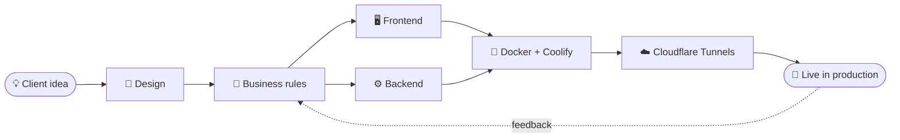

<!-- ENGLISH VERSION -->
<a id="top"></a>


<div align="center">


<br/>


<a href="https://linkedin.com/in/bryan-mamani-3a736539b"></a>
<a href="mailto:mamani.bryan2505@gmail.com"></a>

<sub><a href="#-about-me">About</a> · <a href="#-how-i-deliver">How I deliver</a> · <a href="#-experience">Experience</a> · <a href="#-featured-projects">Projects</a> · <a href="#-community">Community</a> · <a href="#-tech-stack">Stack</a> · <a href="#-github-activity">Activity</a></sub>

</div>

---

## 🧠 About Me

I'm **Bryan Iban Mamani Quispe**, a Computer Systems Engineering student at **Universidad Privada del Valle (UNIVALLE)** on an academic excellence scholarship. I take products from a client's raw idea to a live production environment, and I run the infrastructure they live on myself.

```yaml
role:        Fullstack developer · end-to-end product delivery
shipping:    Client websites with their own CMS · STAN (research + product)
leading:     President, SOCEISI · La Paz Coordinator, Microsoft User Group Bolivia
speaking:    Global Azure La Paz 2026 · CBA 4th of July Celebration
ai_tooling:  Claude Code, daily since April 2026 (MCP servers + per-project skills)
open_to:     Freelance · per-project remote work · English or Spanish
```

## 🧭 How I Deliver



## 💼 Experience

<details open>
<summary><b>☕ Freelance Fullstack Developer · Hierro Brothers</b> — <i>Sep 2026 – Present · La Paz, Bolivia</i></summary>
<br/>

- New bilingual (ES/EN) website for the brand's **Hospitality, Coffee Collection and Bronze** lines, replacing the old WordPress site
- Custom **in-page content editor**: password + 2FA login, change history with undo, media library
- Dockerised behind an HTTPS reverse proxy, with security tests against the real server

<a href="https://hb-demo.bryanmq.com"></a>&nbsp;

</details>

<details open>
<summary><b>💊 Fullstack Developer · Farmacias Blanco</b> — <i>Jul 2025 – Apr 2026 · La Paz, Bolivia</i></summary>
<br/>

- **Complete development** of the inventory system and its 7 modules: products, categories, purchasing, sales, customers, reports and dashboard, under SOLID and Clean Architecture
- Desktop app with React + Vite + Tauri + SQLite; architecture reworked for multi-branch growth with NestJS + CouchDB
- Staging and production on a VPS with Cloudflare, Coolify and Docker. **In daily production use since April 2026**, with stock discrepancies eliminated


</details>

<details>
<summary><b>🎓 Frontend Developer · Universidad Privada del Valle</b> — <i>May 2025 – Nov 2025 · La Paz, Bolivia</i></summary>
<br/>

- Two **administration modules** of the Alumni Univalle platform (legacy WebForms + WCF) in an 8-person team, in production today
- Reusable module that makes decompiled backend classes readable by Crystal Reports, documented as a guide for other projects
- Researched and proposed SharpPDF as an alternative to Crystal Reports


</details>

## 🚀 Featured Projects

<table>
<tr>
<td width="50%" valign="top">
<h3>🎓 STAN</h3>
<a href="https://stan.isilp.com"></a>

<p>Degree-process tracking system for UNIVALLE: topic proposal → PDF-annotated versions → forms → defences, across 7 roles. <b>Sole developer and researcher</b> of a funded 12-month applied research project.</p>

</td>
<td width="50%" valign="top">
<h3>🏰 Invasión de las Torres</h3>


<p>AR web app for a university competition: 33 teams, 11 lecturer-staffed checkpoints across two towers, a live scoreboard over SSE, and load testing up to 500 live screens.<br/><sub>Reference: inv.isilp.com</sub></p>

</td>
</tr>
<tr>
<td width="50%" valign="top">
<h3>🌆 LA PAZ 2050</h3>
<a href="https://github.com/bryanmq-dev/lapaz-2099"></a>

<p>3D urban-mobility simulation of La Paz built from real OpenStreetMap and SRTM data, with PostGIS spatial alerts and detours; viewable in VR, mixed reality and AR. Presented with a scientific article.</p>

</td>
<td width="50%" valign="top">
<h3>🐾 Doomnimal</h3>
<a href="https://doomnimal.bryanmq.com"></a>

<p>Round-based arcade FPS from a 3-week game jam: online multiplayer over its own WebSocket relay and a VR mode. I built the whole core game in a 3-person team.</p>

</td>
</tr>
<tr>
<td width="50%" valign="top">
<h3>🍦 Helados Panda</h3>

<p>Transactional and management systems over a data warehouse with incremental ETL, KPI tracking and an AI query assistant.</p>

</td>
<td width="50%" valign="top">
<h3>🧳 ChaskiTours</h3>

<p>Travel booking and management with Stripe payments and .NET Core Identity roles, migrated to plain Blazor to fix HttpOnly cookie failures.</p>

</td>
</tr>
<tr>
<td width="50%" valign="top">
<h3>🛡️ Redbox Cybersecurity</h3>

<p>Visibility, blog and certificate-verification site for a cybersecurity community.</p>

</td>
<td width="50%" valign="top">
<h3>🦎 SOCEISI platforms</h3>
<a href="https://lizardjudge.soceisi.com"></a>
<a href="https://soceisi.com"></a>
<p>I deploy and run the society's platforms: LizardJudge (online judge), <a href="https://voluntariosunivalle.soceisi.com">Voluntarios Univalle</a> and soceisi.com.</p>

</td>
</tr>
</table>

## 🌱 Community

| | Role | Highlights |
|:-:|---|---|
| 🏛️ | **President**, Computer Systems Engineering Scientific Society (SOCEISI), UNIVALLE · *2025 – present* | ~550 students · board grew from 10 members to 55 volunteer applications · Competitive Programming School (ICPC), Development Incubator, peer mentoring |
| 🎪 | **Events** | Invasión de las Torres · GitHub Copilot Dev Days (host venue) · FLISOL 2026 · OpenLab I & II |
| 🪟 | **La Paz Coordinator**, Microsoft User Group Bolivia | Local community and events |
| 🎤 | **Speaker**, Global Azure La Paz 2026 · CBA 4th of July Celebration | AI assistant with augmented reality on Azure AI Foundry, Speech AI, Whisper and MediaPipe |

## 🧰 Tech Stack

<table>
<tr><td><b>Languages</b></td><td></td></tr>
<tr><td><b>Frontend & Desktop</b></td><td></td></tr>
<tr><td><b>Backend</b></td><td></td></tr>
<tr><td><b>3D, XR & Games</b></td><td></td></tr>
<tr><td><b>Data</b></td><td></td></tr>
<tr><td><b>DevOps</b></td><td></td></tr>
</table>

<sub>Also: Fastify · TanStack Start · Blazor · PostGIS · CouchDB · Coolify · Caddy · Cloudflare R2 · WebXR · Claude API</sub>

## 📊 GitHub Activity

<div align="center">

<br/><br/>

<br/>
<picture>
  <source media="(prefers-color-scheme: dark)" srcset="https://raw.githubusercontent.com/bryanmq-dev/bryanmq-dev/output/github-snake-dark.svg"/>
  <source media="(prefers-color-scheme: light)" srcset="https://raw.githubusercontent.com/bryanmq-dev/bryanmq-dev/output/github-snake.svg"/>
  
</picture>
</div>

<div align="center">
<br/>

<br/><sub><a href="#top">⬆ Back to top</a></sub>
</div>


